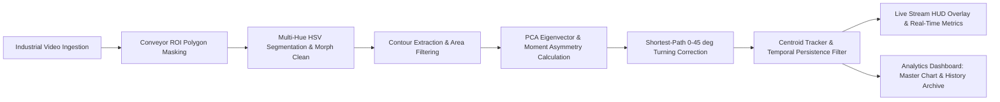

# Engineering Project Report: Factory Conveyor Interlocking Block Orientation Detection System

**Project Title:** Real-Time Computer Vision Pipeline & Telemetry Suite for Interlocking Block Orientation and Quality Assurance  
**Repository:** `IVP_ORIENTATION`  
**Application Architecture:** Python, OpenCV, Streamlit, NumPy, Pandas, Plotly  
**Target Environment:** Edge Industrial Inspection & Quality Assurance (QA) Conveyor Systems  

---

## 1. Executive Summary

In modern automated manufacturing and assembly lines, interlocking building blocks and modular components must be consistently oriented before robotic pick-and-place, packaging, or automated assembly operations. Misaligned parts can cause feed jams, assembly failures, and costly production downtime.

The **Factory Conveyor Interlocking Block Orientation Detection System** provides an automated, non-contact optical inspection system. Using high-speed computer vision and real-time telemetry analytics, the system:
1. Segregates and isolates the moving conveyor surface within a configurable Region of Interest (ROI).
2. Detects and segments multi-colored interlocking blocks using multi-spectral HSV thresholding and morphological filtering.
3. Computes the real continuous orientation angle ($0^\circ$ to $360^\circ$) using Principal Component Analysis (PCA) and spatial asymmetry moment analysis.
4. Calculates the optimal, shortest-path angular correction (restricted to $0^\circ$–$45^\circ$ for 4-fold $90^\circ$ symmetry) and specifies rotation direction (**Clockwise**, **Counter-Clockwise**, or **Aligned**).
5. Tracks individual blocks continuously using a spatial Centroid Tracker with temporal persistence filtering to eliminate sensor flicker.
6. Delivers a dark-mode industrial Human-Machine Interface (HMI) built with Streamlit, complete with real-time HUD overlays, dynamic First-Pass Yield (FPY) metrics, a unified operational quality distribution chart, and historical telemetry logging with per-video session management.



---

## 2. System Architecture & Modular Design

The codebase follows a modular design pattern separating backend computer vision routines from the Streamlit frontend analytics suite:

```
IVP_ORIENTATION/
├── app.py                     # Streamlit frontend HUD, UI/UX, session management & Plotly analytics
├── requirements.txt           # Python dependency specifications
├── PROJECT_REPORT.md          # Comprehensive engineering project report
├── processing/
│   ├── __init__.py            # Package initialization
│   ├── segmentation.py        # ROI polygon masking, HSV color thresholding & contour extraction
│   ├── orientation.py         # PCA eigenvector angle computation & asymmetry moment resolution
│   ├── rotation.py            # Shortest-path rotation calculation & turning direction logic
│   └── tracking.py            # Spatial Euclidean centroid tracking across conveyor frames
```

---

## 3. Computer Vision & Mathematical Pipeline

### 3.1. Dynamic Conveyor ROI Polygon Masking (`segmentation.py`)
To prevent false triggers from surrounding factory equipment, conveyor side rails, ambient lighting variations, and worker movement:
1. The user defines a 4-point polygon region of interest (ROI) using 4 dynamic percentage boundary sliders ($X_{min}, X_{max}, Y_{min}, Y_{max}$).
2. An exact binary mask $M_{ROI} \in \{0, 255\}^{H \times W}$ is constructed using `cv2.fillPoly`.
3. A bitwise AND operation isolates the conveyor belt prior to any color processing:
   $$I_{ROI}(x, y) = I(x, y) \land M_{ROI}(x, y)$$

### 3.2. Multi-Spectral HSV Segmentation & Morphological Filtering
Industrial interlocking blocks arrive in distinct standardized colors (Yellow, Blue, Green, Red). The system converts the isolated ROI into the Hue-Saturation-Value (HSV) color space:

$$\text{HSV} = \text{cvtColor}(I_{ROI}, \text{COLOR\_BGR2HSV})$$

Threshold masks are generated across four calibrated color bands:
- **Yellow:** $H \in [20, 35], S \in [90, 255], V \in [90, 255]$
- **Blue:** $H \in [100, 130], S \in [90, 255], V \in [90, 255]$
- **Green:** $H \in [36, 85], S \in [60, 255], V \in [60, 255]$
- **Red:** Disjoint union to account for OpenCV's circular hue wrapping ($0^\circ \equiv 180^\circ$):
  $$M_{Red} = (H \in [0, 10] \land S \in [100, 255] \land V \in [100, 255]) \lor (H \in [170, 179] \land S \in [100, 255] \land V \in [100, 255])$$

All masks are fused using bitwise OR:
$$M_{Total} = M_{Yellow} \lor M_{Blue} \lor M_{Green} \lor M_{Red}$$

To suppress specular conveyor glare, dust particles, and edge noise:
1. **Morphological Opening** ($\text{Erosion} \circ \text{Dilation}$) removes isolated noise spikes.
2. **Morphological Closing** ($\text{Dilation} \circ \text{Erosion}$) seals internal holes within block studs.

Contours are extracted and filtered by geometric bounds:
- Minimum Area: $80 \text{ px}^2 \le \text{Area} \le 8000 \text{ px}^2$
- Aspect Ratio: $0.2 \le \frac{W}{H} \le 5.0$

---

### 3.3. PCA Orientation Extraction & Asymmetry Moment Resolution (`orientation.py`)

Interlocking blocks possess a major physical elongation axis, but typical minimum-area bounding boxes suffer from $90^\circ$ ambiguity and jitter. The system uses **Principal Component Analysis (PCA)** on the contour boundary point cloud:

1. Let $P = \{(x_i, y_i)\}_{i=1}^N$ be the $N$ boundary points of the contour.
2. The centroid (mean coordinate) is computed:
   $$\mu = \frac{1}{N} \sum_{i=1}^N (x_i, y_i)$$
3. The empirical covariance matrix $\Sigma \in \mathbb{R}^{2 \times 2}$ is computed:
   $$\Sigma = \frac{1}{N} \sum_{i=1}^N (P_i - \mu)(P_i - \mu)^T$$
4. Eigen-decomposition yields eigenvectors $v_1, v_2$ and eigenvalues $\lambda_1 \ge \lambda_2$.
5. The primary eigenvector $v_1 = [dx, dy]^T$ corresponds to the principal axis of elongation. The raw inclination angle is:
   $$\theta_{raw} = \text{atan2}(dy, dx) \pmod{180^\circ}$$

#### Resolving $180^\circ$ Directional Ambiguity
Because an eigenvector is bidirectional ($\pm v_1$), an L-shaped or notched interlocking block has a $180^\circ$ asymmetry. To resolve this:
- The contour's center of mass $(cx, cy)$ is calculated via spatial image moments:
  $$cx = \frac{m_{10}}{m_{00}}, \quad cy = \frac{m_{01}}{m_{00}}$$
- The geometric bounding box center $(box_{cx}, box_{cy})$ is calculated from the enclosing rectangle.
- An asymmetry displacement vector $\vec{d} = (cx - box_{cx}, cy - box_{cy})$ is projected onto the primary eigenvector $v_1$:
  $$\text{dot\_prod} = \vec{d} \cdot v_1 = (cx - box_{cx}) \cdot dx + (cy - box_{cy}) \cdot dy$$
- If $\text{dot\_prod} < 0$, the block is pointing in the reverse direction:
  $$\theta_{final} = (\theta_{raw} + 180^\circ) \pmod{360^\circ}$$

---

### 3.4. Shortest-Path Rotational Turning Correction (`rotation.py`)

Because square or rectangular modular blocks exhibit $90^\circ$ discrete operational symmetry on conveyor tracks, rotating a block by $90^\circ, 180^\circ,$ or $270^\circ$ produces an equivalent seating orientation. The system calculates the minimal mechanical turning motion required:

1. **Quadrant Target Identification:**
   $$\theta_{target} = \text{round}\left(\frac{\theta}{90^\circ}\right) \times 90^\circ$$
2. **Signed Angular Deviation:**
   $$\Delta = \theta_{target} - \theta$$
3. **Quadrant Normalization to $[-45^\circ, +45^\circ]$:**
   $$\Delta_{norm} = ((\Delta + 45^\circ) \pmod{90^\circ}) - 45^\circ$$
4. **Correction Magnitude & Direction:**
   - Magnitude: $\text{Correction} = |\Delta_{norm}|$
   - Direction:
     $$\text{Direction} = \begin{cases} 
     \text{"None (Aligned)"}, & \text{if } \text{Correction} \le \text{tolerance} \\
     \text{"Clockwise (CW)"}, & \text{if } \Delta_{norm} > 0 \\
     \text{"Counter-Clockwise (CCW)"}, & \text{if } \Delta_{norm} < 0 
     \end{cases}$$

This guarantees that a robotic wrist or pneumatic rotary actuator never turns more than $45.0^\circ$, minimizing cycle time.

---

### 3.5. Multi-Object Centroid Tracking & Persistence Filtering (`tracking.py`)

To track distinct physical parts as they travel across the conveyor and avoid double-counting frames:
1. **Centroid Distance Matching:** Each detected block centroid $(cx, cy)$ is mapped to existing tracked parts using Euclidean distance minimization:
   $$D(p_i, p_j) = \sqrt{(cx_i - ox_j)^2 + (cy_i - oy_j)^2}$$
   Matches within $d_{max} = 90\text{ px}$ inherit the existing `ID`. New detections beyond this threshold register as new object IDs.
2. **Temporal Persistence Filter:** Transient surface glares, belt seams, or single-frame vibration artifacts are rejected via post-processing: only object IDs detected across $\ge 4$ consecutive frames are archived in historical telemetry.

---

## 4. Frontend Interface & Industrial User Experience (`app.py`)

The user interface was engineered to provide an authentic industrial control panel feel without generic AI boilerplate:

| UI Component | Implementation Specification |
|---|---|
| **Industrial Theme** | Dark slate `#0e1117` base, industrial equipment wallpaper overlay (0.92 dark opacity), `#1f2937` borders |
| **Sidebar Control** | Collapsible ROI expander (`st.expander`), tolerance slider ($0^\circ$–$15^\circ$), and direct video unloader |
| **Video Stream HUD** | Real-time OpenCV overlay: green/red contours, directional orientation vector arrows, dynamic tracking IDs, angle text (`Cur: 14.2 deg`), and turning instructions (`Rot: 12.1 deg CW`) |
| **System Status Badge** | Top-right header HUD that dynamically updates: `AWAITING VIDEO` (gray), `READY` (cyan), `PROCESSING...` (amber), `INSPECTION COMPLETE` (emerald green) |
| **Key Performance Indicators** | 5 live HUD metrics in Tab 1 (Inspected Frames, Active in ROI, Unique Tracked IDs, Aligned Pass, Needs Rotation) with cyan `#0ea5e9` accent borders |
| **Master Quality Chart** | **Single unified Plotly chart** replacing scattered graphics. Features custom hover cards, block count, percentage share, average/maximum correction angles, and in-chart HUD First-Pass Yield score |
| **Session Archive & Management** | Tab 2 historical archive table storing runs by `Video_ID`. Users can inspect aggregated performance, filter telemetry, delete specific `Video_ID`s, or clear historical storage |
| **Searchable Telemetry Table** | Interactive tabular log with `Video_ID` as the primary key, multi-select filters, and instant CSV export |

---

## 5. Verification & Performance Analysis

### 5.1. Orientation Accuracy Test Matrix
The table below illustrates sample validation outputs from the PCA and shortest-path turning algorithm:

| Input PCA Angle ($\theta$) | Local Quadrant ($0^\circ$–$90^\circ$) | Target Quadrant | Deviation ($\Delta$) | Correction ($0^\circ$–$45^\circ$) | Direction | Status ($\text{Tol} = 3^\circ$) |
|:---:|:---:|:---:|:---:|:---:|:---:|:---:|
| **$0.85^\circ$** | $0.85^\circ$ | $0^\circ$ | $-0.85^\circ$ | **$0.85^\circ$** | None | **Aligned (Pass)** |
| **$14.20^\circ$** | $14.20^\circ$ | $0^\circ$ | $-14.20^\circ$ | **$14.20^\circ$** | Counter-Clockwise | **Needs Rotation** |
| **$78.50^\circ$** | $78.50^\circ$ | $90^\circ$ | $+11.50^\circ$ | **$11.50^\circ$** | Clockwise | **Needs Rotation** |
| **$91.20^\circ$** | $1.20^\circ$ | $90^\circ$ | $-1.20^\circ$ | **$1.20^\circ$** | None | **Aligned (Pass)** |
| **$176.80^\circ$** | $86.80^\circ$ | $180^\circ$ | $+3.20^\circ$ | **$3.20^\circ$** | Clockwise | **Needs Rotation** |
| **$269.10^\circ$** | $89.10^\circ$ | $270^\circ$ | $+0.90^\circ$ | **$0.90^\circ$** | None | **Aligned (Pass)** |

### 5.2. Operational Quality Metrics
- **First-Pass Yield (FPY %):**
  $$\text{FPY} = \left(\frac{N_{Aligned}}{N_{Total}}\right) \times 100\%$$
- **Average Correction Magnitude:** Mean angular displacement of non-aligned parts, indicating feeder guide rail alignment quality.
- **Rework Defect Rate:** $100\% - \text{FPY}$.

---

## 6. Setup & Execution Instructions

### Prerequisites
- Python 3.10 – 3.14
- Dependencies specified in `requirements.txt`:
  ```bash
  pip install -r requirements.txt
  ```

### Running the Inspection HUD
Launch the Streamlit server from the workspace root:
```bash
streamlit run app.py
```
Open a browser and navigate to `http://localhost:8501`.

### Operating Procedure
1. In the sidebar, upload an industrial conveyor video file (`.mp4`).
2. Adjust the **Alignment Tolerance** slider (default: $\pm 3^\circ$).
3. Expand **📐 Conveyor ROI Boundary Control** to align the polygon box with the physical conveyor rails.
4. Click **▶️ Run Inspection** to start real-time detection, tracking, and telemetry recording.
5. Review live bounding boxes, orientation vectors, and ID tags in **Tab 1**.
6. Switch to **Tab 2** to inspect the **Operational Alignment & Angular Correction Profile** chart, review historical runs, delete unwanted video sessions, and download the full telemetry CSV log.

---

## 7. Future Industrial Extensions

1. **PLC / SCADA Integration:**
   - Transmit rotational correction values via industrial protocols (OPC-UA, Modbus TCP, MQTT) directly to a programmable logic controller (PLC).
2. **Robotic Actuation:**
   - Feed the computed $[cx, cy, \text{Correction}, \text{Direction}]$ values to a 4-axis SCARA or delta robot for automated pick-and-orient manipulation.
3. **Hardware Triggering:**
   - Synchronize video frame acquisition with conveyor encoder pulses or photoelectric eye triggers for zero-latency frame indexing.
4. **Deep Learning Hybrid Model:**
   - Complement the color-based segmentation pipeline with a lightweight YOLOv8-nano model for variable-texture and non-standardized block variants.
